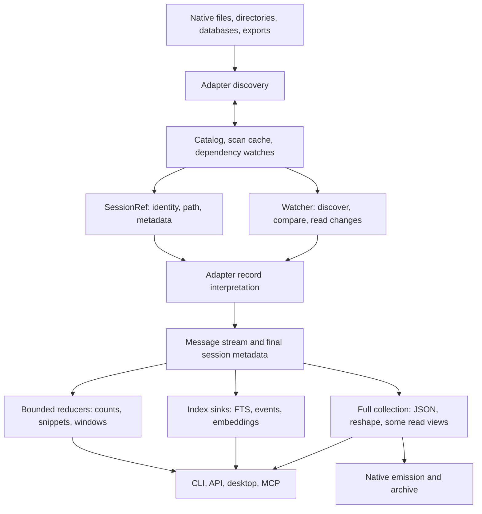

# Store datapaths: the system we are optimizing

The design core of the 2026-10-12..14 datapaths pass. The dated work log, per-batch evidence and
completion reports that used to follow live in git history (`git log -- docs/design/DATAPATHS.md`).
Budgets and measured numbers are in [`PERF.md`](PERF.md). Paths below are relative to `crates/`.

## What cv does

cv discovers sessions in heterogeneous stores, interprets their native histories into a common
message IR, and serves several different products from that IR: transcript reading, structured
facts, full-text/semantic search, live following, archives, datasets, and native session reshaping.
The task log is a separate event-sourced coordination store. Native CLI, HTTP, desktop and MCP
share much, but not all, of their read implementation. Browser upload is a separate, owned-memory
ingestion path for Claude, Codex and Gemini.

The key distinction is **source traversal, interpretation, payload decoding, retention, and
output**. Calling a method `stream` bounds none of those automatically. A reader can retain the
whole source before its first callback; a sink can collect everything; a bounded output chunker
can decode a whole field first. Each bound must hold across the composed path.

## Existing foundations to retain

- Discovery already parallelizes adapters and many per-file scans (`cv-core/src/lib.rs`).
  Warm ordinary listings use the catalog and scoped freshness probes; they need no body parse.
- The common API is `Adapter::stream` plus `MessageSink`. `parse` is collection over that API.
  `ParseOptions` separates full extras, format-complete carriers, lazy text spans and offsets.
- Claude/Codex have lazy source spans and resumable stream state. Codex has a useful direct path
  for giant tool outputs; most unchanged index jobs are skipped.
- FTS already combines text, event and affordance extraction in one pass, uses one writer,
  streams body documents through a bounded channel, and publishes resume marks after commit.
  Its scheduler already admits at most 2 GiB of estimated **source file bytes**.
- OpenCode, Goose and Hermes use per-session row iteration and the stores' existing indexes.
  Fixture query plans also support Devin's chain lookups and OpenClaw's event sequence query.
  Do not replace these with speculative PRAGMA tuning.
- Text `show --last N` already uses one lazy pass and a bounded deque. API message pages are
  lazy windows; event queries and `has:` counts have useful catalog fast paths.

## Reader inventory

This describes implementation, not a blanket performance claim. Required navigation state and
demanded output are not themselves avoidable bloat.

| Store / format | Current traversal and retained state | Remaining costs / limits |
|---|---|---|
| Claude JSONL | One record codec (`claude/record.rs`, see [`CODEC.md`](CODEC.md)) over the shared JSONL reader in both builds; lazy text/arguments, facts, usage, discovery and fork heads are demands on it; checkpoints | Complete-mode carriers and metadata, rich `toolUseResult` sidecars and array tool results under 64 KiB remain owned |
| Codex JSONL | one record codec over `jsonl::for_each_line` (mapped or positioned); bounded authority prepass; demand picks spans/inline/heads, never the decoder | Full/unknown metadata remains owned, and discovery retains its small-file full-scan / sampled head-tail policy |
| Codex legacy JSON / zstd | Legacy documents feed the same codec item by item; compressed modern JSONL decodes once per read into one arena read by the same line source; `cv index` reads discovery's arena, within a 2 GiB decoded window | Demanded rich fallback fields; decoded/staged disk extent; no general compressed incremental marks |
| Gemini legacy JSON | Checked selected string/canonical/composite results and formatted thoughts; native mmap or portable range projections | Full/complete modes and rich display extras still own required payloads |
| Gemini JSONL | Native mmap and portable checked-range replay retain compact order/keys; selected composite bodies use one session arena | Must scan complete history for replacements/rewinds; required metadata and rich display extras remain owned |
| Qwen modern JSONL | Checked selected reading, discovery, complete preparation, export and verification; finalized-record checkpoints | Requested title/metadata ownership; full replay systemPayload bookkeeping remains owned; no local fleet coverage |
| Kimi | Checked context bodies and cold discovery share positioned rotation handling; pending usage and wire enrichment preserved | Rotated fingerprint/navigation state and mutable trailing usage; requested metadata remains owned |
| Kimi Code | Selected cold wire/state discovery and checked finalized-step/complete playback; raw envelopes retain shared checked backing | Call/step state, requested title/cwd, unknown complete carriers and output backing extent |
| Grok | Checked selected reading, complete preparation/export/verification; mapped and positioned discovery/status projection | Header/system metadata remains owned; enrichment can revise old messages; portable rewind/hook framing now shares the metadata reader |
| Cline/Roo legacy | Shared selected-record source views, lazy text/arguments and bounded workspace extraction | Rich metadata, encoded arguments and selected composite output remain |
| Cline SDK | Shared source views, raw records and Anthropic block dispatch; large arguments use Json ranges | Selected rich fields and compatibility edge cases; giant full-output parity remains separate |
| Continue | Native/positioned typed header and selected-record source views; lazy payloads, checked encoded arguments and tool-answer dedup | Joined selected text, answer-ID state, rich metadata and mutable snapshots remain |
| OpenCode files | Ordered message descriptors, selected headers/parts and shared payload arena; deduplicated source inventory released before publication | Necessary file inventory grows with part count; native and portable late-query miss gates now pass |
| OpenCode SQLite | Indexed selected parts and checked complete native records; guarded DB/WAL/journal dependencies and faithful native replay | Encoded input validation/spill costs; demanded metadata; exports do not clone external linked child/shell stores; native SQLite and demanded output costs remain |
| Cursor SQLite | CLI/ACP reachable-message replay and IDE composer projections; selected strings, Lexical rich text and structured results share private backing | Encoded rich-text CPU cost, owned identifiers/full metadata, WITHOUT ROWID fallback |
| Devin SQLite | Compact forest, incremental checked message/metadata cells, reused compaction backing and bounded history-path inspection | Native SQL evaluation; navigation descriptors; prefix prompts/demanded rich extras; non-rowid owned fallback |
| Hermes SQLite | Indexed rows, bounded exact prompt suppression, transactional exports and checked ordinary/multimodal complete bodies; sidecars decoded once | Ordinary lean reads still own bodies/extras. Giant output rows/FTS allocate natively; prompt-only CPU tradeoff remains documented |
| Goose SQLite / legacy | Selected rows and framed legacy payload views; lean demand avoids unrelated sidecars | Full demanded metadata and explicit owned output remain; decoding/staging costs differ by shape |
| OpenClaw JSONL / SQLite | Flat/tree/SQLite checked payload replay shares branch selection; cells copied incrementally, compressed events staged in bounded chunks | O(events) navigation/backing; codec workspace; demanded complete/control/system metadata; native-cell and non-rowid fallbacks |
| Zed SQLite | Incremental blobs decoded once; lazy messages use checked selected text/arguments and skip discarded attachment bodies | Typed discovery counts avoid message trees; largest decoded string still grows Serde scratch; decoded spill, requested metadata and WITHOUT ROWID native-cell fallback |
| LM Studio | Schema-selected document/turn views, selected lazy text spans and incremental variants; mapped or positioned sources | Bounded discovery title prefixes; Harmony decoding and arbitrary demanded output/metadata remain owned |
| ChatGPT / Claude account exports | Bounded metadata cache and positioned source views; selected-conversation replay | Branch descriptors, joined text and selected owned output; sender/empty-archive corrections have focused source oracles |
| OpenSession | Shared source validation/views and per-message IR projection | Selected authoritative rich fields remain owned; giant serialization proof separate from count/discovery |

Registry: `cv-core/src/harness/mod.rs`; implementations under `cv-core/src/harness/`.
Directory entry sizes and whole database sizes are **not** per-session transcript byte counts.
Compressed, encoded, scanned, decoded and emitted bytes must be labeled separately.

## Consumer inventory

| Operation | Actual work | Optimization boundary |
|---|---|---|
| Warm ls/stats | Catalog probe, metadata rows, sort/filter | Preserve cheap path; measure discovery separately |
| Full discovery | Projected counts/metadata + cache persistence + catalog replacement/watch construction | Required content validation, dependency inventory and exact totals still scan demanded sources |
| Text windows / last N | Lazy range or deque, selected messages materialized | Already useful bounds; giant selected output is still output-sized |
| JSON show / MCP show | CLI show/export stages resolved frames and envelopes in bounded spill storage; EOF metadata retained. MCP stages selected windows | CLI Last retains lazy tail descriptors; owned adapter extras and redaction trees remain; MCP client payload size and subprocess startup |
| Affordance view | Facts projection into classified rows; checked bounded text summaries | Unprojected adapters retain rich extras; side stores and result rows; escaped validation still traverses the whole field |
| Doctor | Facts projection; checked text lengths and JSON writer counts | Attribution state, unsupported adapter rich/fallback parsing and demanded structured arguments |
| Query text predicate | Exact index-only matching IDs; cheap tri-state evaluation before parse | Mixed predicates still parse when cheap facts cannot decide |
| Other rich predicates | Predicate-sized streamed tool/model facts and shared source probes | Distinct unresolved relative paths retained until final cwd; compaction uses its existing separate boundary |
| FTS | Chunked text, bounded event spool and byte-capacity permits held through Tantivy document consumption; counts/checkpoints and one catalog connection per sweep | Writer arenas coexist with admitted documents |
| Semantic indexing | Shares discovery inventory; source/model identity enables unchanged-vector reuse and deferred model load; atomic streamed save | Requested vector-store storage grows with session count; ranking candidate retention is now limited by requested result count |
| API pagination / HTTP windows | Verified page checkpoints and head metadata cache; selected HTTP JSON stages bounded frames through shared window selection | Window JSON parsing, demanded metadata and individual visible-message payloads remain; complete downloads use staged native writers |
| Watch | Verified checkpoints and bounded EOF metadata reused across tail polls | Strict source identity and dependencies; replay-only formats retain fallback parsing |
| Archive | Verified suffix read; bounded message spool and guarded canonical prefix copy; checked streaming payload output | Complete replacement artifact still writes O(output bytes); metadata width remains owned |
| Dataset | Streamed selection and bounded output staging; late predicates retain source descriptors in private spools | Bounded slice decoding reduces matched-query spool CPU; demanded owned producer fields remain |
| Pack/tools/token stats | Tool histograms fold per-message event scratch; pack excerpts use a ring; ordered usage rows reuse a bounded dependency-validated cache | Cold ledger publication, exact dedup I/O and model roster growth; tiny native sources bypass caching |
| Reshape/emit | Bounded shared JSONL stage; native Codex and Claude ports retain checked lazy bodies; verification reduces compact facts | Message roster/selected metadata, same-harness complete carriers and other emitters/materializing thinking transforms |
| Distill/findings | Shared analysis demand and one prepared tail; findings omit unused products and resolve text per message; --upto loads selected messages; borrowed sidecars use bounded staging | Ordinary CLI loads retain checked sources; analysis owns demanded products per message. Requested tails, notes, argument/result fallbacks, rich extras and prose remain output-sized; staged sidecar bytes scale with output |
| Prune/revive | Compact selection facts and source positions; checked Thinking, ASCII declassification, usage and linked-input projections; transcript/sidecar staging | Selected Unicode fields and oversized metadata retain owned fallbacks; validation and output staging remain required work |
| MCP observe | Retained-message watch callbacks and checked capped searchable prefixes | Other full producer modes, owned metadata and uncapped MCP show windows remain separate |
| Task coordination | Replay full append-only task log under CAS for writes | Separate workload; snapshot/tail only if measured task volume warrants it |

Key sources: `cv/src/cmd/view.rs`, `cv-core/src/{api,affordance,watch,lazy,stream}.rs`,
`cv-search/src/{fts,semantic}.rs`, `cv/src/cmd/{query,archive,pack,compose}.rs`.

## Correctness boundaries before reuse

1. Physical append does not imply logical append. Gemini replacement/rewind and OpenClaw leaf
   changes can replace an old visible suffix; Kimi usage, Kimi Code unfinished steps and Grok
   reasoning can revise the last pending message. Checkpoint only finalized output/state.
2. Identity includes dependencies: SQLite WAL, directory children, side metadata, rotation
   manifests and sidecar output. Existing freshness policies disagree about these dependencies.
   Catalog DB watches include WAL appearance, modification and disappearance. Counts, events and
   each search index now keep separate canonical dependency metadata baselines, tied to the primary
   tuple. SQL output and stamps publish atomically; FTS invalidates its old baseline before changes
   and publishes a revalidated baseline after commit. Operation-local probes share file stats.
   Known adapter-local sidecars, directory members and WAL files are covered. Consumers capture
   conditional Claude fork siblings and resolved external output paths before reading them, including
   absent files. Complete read sets survive prefix checkpoints and are revalidated at publication.
   Source records older than version 3 reread once through normal refresh to capture primary identity; that source migration needs no additional index rebuild.
3. Current resume marks sample the first 4 KiB and the 4 KiB preceding the mark. This is not a
   proof that the entire prefix is unchanged. FTS now requires growth before using a mark, so
   same-size rewrites take a whole pass; inode replacement also rejects reuse. A rewrite followed by
   growth can still escape the samples. Unix unchanged reuse now additionally checks inode/ctime,
   rejecting same-size restored-mtime rewrites; platforms without that identity retain length/mtime guards.
   Unconditional detection of arbitrary prefix edits requires reading that prefix or a trusted
   writer/filesystem change signal; do not promise both zero prefix reads and such detection.
4. Lazy/full equivalence must compare **resolved content** and metadata. The existing stream dump
   serializes span descriptors, not their resolved text. Span layout changes are not output changes.
5. Existing format bugs must be isolated and tested as correctness changes. Fixed separately:
   Codex's giant-output shortcut dropped metadata preserved by its ordinary branch; Gemini's native
   wrapper omitted metadata fields and rejected escaped borrowed strings.
6. Exact final metadata can require EOF, even when a window needs only early messages. Separate
   payload retention from metadata traversal rather than silently returning incomplete metadata.

## Engineering direction

Optimize the composition, in this order:

1. **Consumer demand:** stop collecting payloads that a view discards; separate index matches from
   snippet generation. Use existing sinks and APIs rather than another command family.
2. **Payload lifetime:** genuinely bounded decoding for escaped spans, typed borrowed hot records,
   metadata-only discovery, raw source ranges for replay bodies. Preserve full/complete modes.
3. **Source/dependency identity:** consolidate invalidation and make format-specific stable append
   boundaries explicit before adding more resume implementations.
4. **Repeated work:** share passes, archive references, parsed metadata and verified positions where
   lifetime/invalidation makes reuse sound. Do not create a new persistent index without evidence.
5. **Concurrency:** once per-operation working sets are known, charge actual conservative working
   cost; bound in-flight payloads and writer queues. Parallelize independent work without multiplying
   unbounded allocations. File-backed resident pages and private heap need different interpretation.

No promised multiplier applies to every path. Exact first-run counts over an unindexed fleet
require reading their records unless the harness supplies authoritative metadata. A 300 ms listing
budget cannot justify pretending exact counts can be recovered without those reads.

## Measurement method

Every change needs a narrow behavioral counterexample or measured cost, followed by composed-path
verification: direct adapter discard/count, discovery, derived views, windows, full output,
incremental index/watch, and writer costs, over tiny records, giant escaped/unescaped text, tool
arguments, many records, replay controls and database WAL changes.

Record instructions, decoded or traversed bytes, messages, allocation requests, peak live
allocations and staged bytes. Keep output hashing outside measured work. Wall/CPU, RSS and macOS
footprint observations explain investigations; they do not override work counting. Use
explicit-root adapters and frozen scratch sources; never mutate the real stores. Cold/warm
identifies application state, not a claim that the OS page cache was evicted.

## Open gaps

- **Per-adapter codecs.** "Never materialize" was built inside each adapter (owned, selected,
  portable and lean variants, mmap and positioned branches, parity tests between them) instead of
  one demand-driven projection per wire format over one byte-window type. The CI heap gate and
  corpus goldens are the invariants a consolidation must keep.
- **Explicit remaining costs.** Grok sibling lineage keeps per-query sibling metadata guards. Kimi
  wire enrichment and Kimi Code's auxiliary session index reread changed prefixes. Claude
  compaction fork inference can inspect sibling prefixes and bodies. External SQLite schemas
  without native indexes cannot be repaired (we never write user stores). OpenClaw custom or
  over-budget schemas keep per-parent SQL scans. The inventory estimate does not bound a giant
  cell's native SQLite allocation. Zed discovery still grows Serde string scratch; Hermes raw
  reasoning/provider extras and native row/FTS allocation remain owned.
- **Resume-mark sampling** (correctness boundary 3) cannot detect an arbitrary prefix rewrite
  followed by growth without reading the prefix or a writer/filesystem change signal.
- **First-run listing and full live recount** budgets in `PERF.md` are not re-established.
- **Zed authored-thread capture.** The isolated GUI attempt could not drive the GPUI agent editor
  and produced no threads; see `tools/harness-corpus/zed/README.md`.
- **Sharpened native child under a live parent.** Installing one and measuring its resumed
  behavior is an unrun experiment; byte savings do not establish preserved reasoning.
